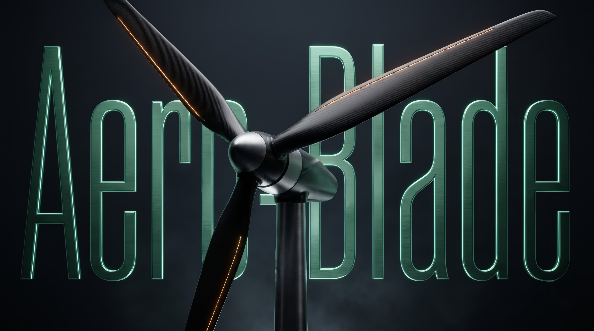
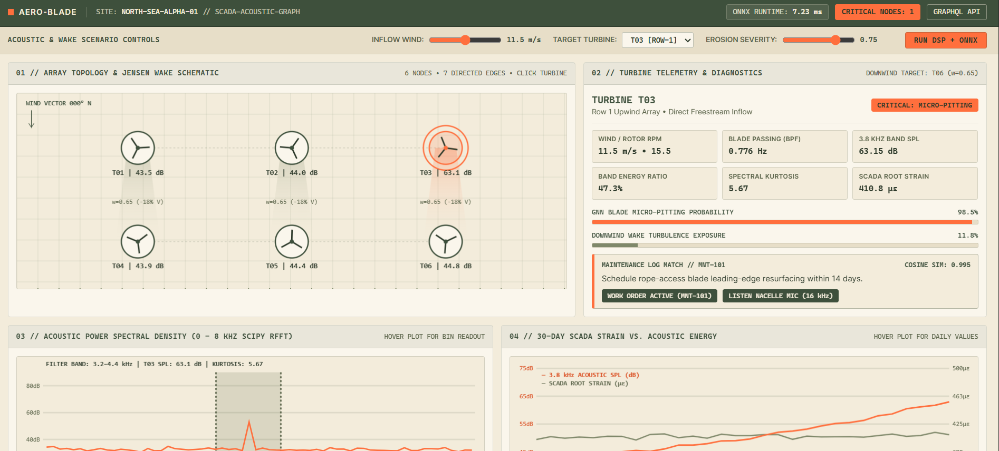
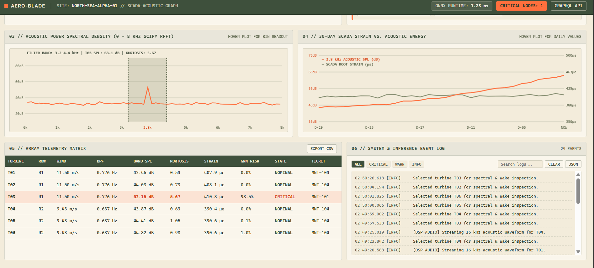
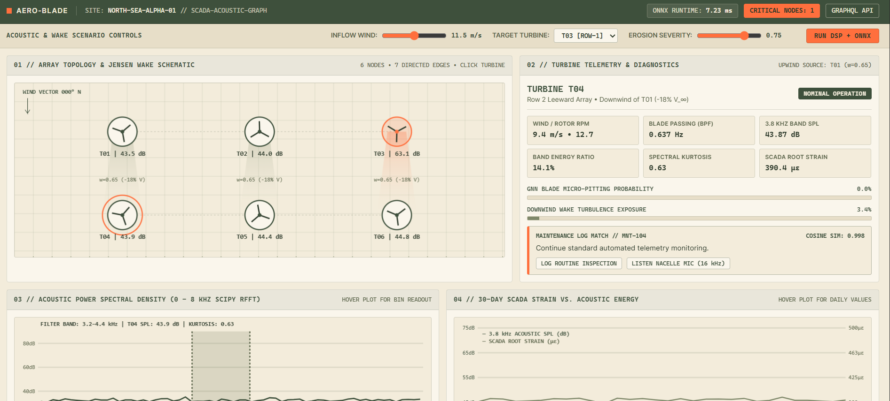
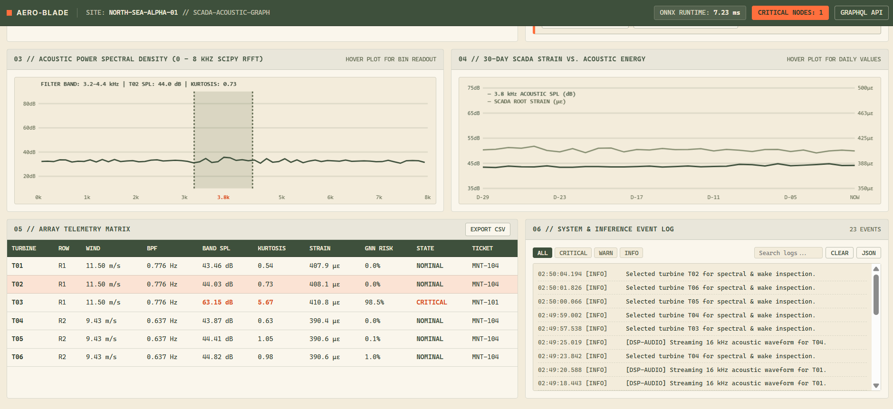
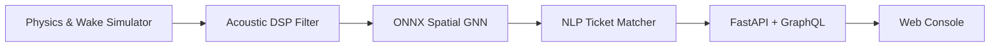

<div align="center">
  

  <h1>Aero-Blade</h1>
  <p>Early-warning wind turbine blade health monitoring using aero-acoustics and spatial graph networks.</p>

  <p>
    
    
    
  </p>

  <p>
    
    
    
    
    
    
  </p>
</div>

> **Work in Progress (`v0.9.0-beta`):** This project is still under active development. The 16 kHz acoustic DSP pipeline, ONNX graph model, maintenance ticket matcher, GraphQL API, and web console are working locally. Real SCADA dataset replay and database persistence are next on the list.

---

## Why I Built This

Wind farms usually rely on structural strain sensors that only trigger an alarm after a blade is already badly worn. Aero-Blade catches tiny pits on the leading edge of a blade (micro-pitting) much earlier by listening for the high-pitched whistle a rough blade makes as it cuts through the air.

Because front-row turbines create turbulent wind wakes for the turbines behind them, a simple volume threshold triggers false alarms. Aero-Blade models the farm as a directed graph in ONNX Runtime so it can separate actual blade damage from downwind turbulence, then matches the alert to past technician notes.

---

## Screenshots

<table>
  <tr>
    <td width="50%">
      
      <p align="center"><sub><b>Fault Isolation:</b> Turbine T03 flagged at 98.5% pitting risk (63.1 dB) while SCADA strain stays flat.</sub></p>
    </td>
    <td width="50%">
      
      <p align="center"><sub><b>Spectral &amp; Trend View:</b> 3.8 kHz RFFT passband spike and 30-day acoustic vs. strain divergence.</sub></p>
    </td>
  </tr>
  <tr>
    <td width="50%">
      
      <p align="center"><sub><b>Wake Awareness:</b> Leeward turbine T04 sees slower wake wind (9.4 m/s) with 0.0% false pitting risk.</sub></p>
    </td>
    <td width="50%">
      
      <p align="center"><sub><b>Farm Matrix &amp; Logs:</b> Live array table, CSV export, and filterable inference event stream.</sub></p>
    </td>
  </tr>
</table>

---

## How It Works



* **`services/simulator/`** — Generates wind vectors, Jensen wake speed drops (`-18%` downwind), SCADA strain logs, and 16 kHz `.wav` blade audio.
* **`services/dsp-worker/`** — Runs a 4th-order Butterworth bandpass filter (`3.2–4.4 kHz`), spectral kurtosis, and envelope FFT locked to the Blade Passing Frequency ($f_{\text{BPF}} = \frac{B \cdot \omega}{60}$).
* **`ml-research/` & `models/`** — PyTorch training code and exported `.onnx` models for the spatial graph network (`farm_gnn.onnx`) and maintenance log matcher (`nlp_log_matcher.onnx`).
* **`services/graphql-gateway/`** — FastAPI + Strawberry GraphQL server handling live scenario runs, RFFT bin calculation, `.wav` audio streaming, and CSV export.
* **`frontend/`** — Vanilla HTML5 Canvas + JS dashboard for inspecting turbine nodes, frequency plots, and audit logs.
* **`deploy/k8s/`** — Basic Kubernetes deployment and load-balancer manifests.

---

## Run It Locally

### 1. Setup & Install
```bash
git clone [https://github.com/](https://github.com/)<your-username>/aero-blade.git
cd aero-blade

python -m venv venv
# Windows:
.\venv\Scripts\Activate.ps1
# macOS / Linux:
source venv/bin/activate

pip install -r requirements.txt
```

### 2. Generate Offline Data & Run Batch Inference (Optional)
```bash
python services/simulator/simulator.py
python services/dsp-worker/dsp_analyzer.py
python services/inference-engine/farm_inference.py
```

### 3. Start the Server
```bash
uvicorn main:app --app-dir services/graphql-gateway --reload --port 8000
```
* **Dashboard:** `http://127.0.0.1:8000/`
* **GraphQL Playground:** `http://127.0.0.1:8000/graphql`

### 4. Run Tests
```bash
pip install pytest httpx
pytest -v
```

---

## Docker & Kubernetes

```bash
docker build -t aero-blade:latest .
docker run -p 8000:8000 aero-blade:latest

# Or deploy to Kubernetes:
kubectl apply -f deploy/k8s/deployment.yaml
```

---

## Roadmap

- [x] Wind farm wake & acoustic waveform simulator
- [x] Butterworth bandpass DSP, kurtosis & RFFT analyzer
- [x] Spatial GNN & NLP log matcher exported to ONNX Runtime
- [x] FastAPI + Strawberry GraphQL API with live `.wav` audio & CSV export
- [x] Interactive HTML5 Canvas dashboard & `pytest` suite
- [ ] **In Progress:** Replay real wind/RPM time-series from open SCADA CSVs (Kelmarsh dataset)
- [ ] **Planned:** TimescaleDB storage for historical telemetry & Helm autoscaling charts